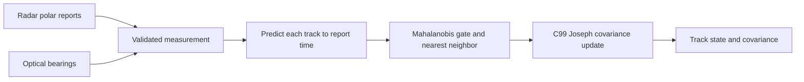

# Multi-sensor track fusion EKF

[](https://github.com/cankaan120/multi-sensor-track-fusion-ekf/actions/workflows/ci.yml)

Four-state east/north position and velocity tracking with a C99 numerical core and
Python association layer. Radar range/bearing and passive optical bearing reports
arrive asynchronously in a common local metric coordinate frame.



## Quickstart (30 Seconds)

```sh
pip install -e '.[test]'
track-fusion --cc gcc
pytest -q
python benchmarks/benchmark.py
```

The CLI explicitly compiles the shared library into a source-hashed user cache.
Completed builds are reused, including while loaded on Windows. Builds publish
atomically from unique temporary files; the cache separates compiler paths,
platforms and pointer widths. Remove the cache entry to rebuild after replacing
a compiler in place.
The wheel includes C source; GCC/Clang must be installed. Library callers construct
`NativeCore(build_native())`, seed a `TrackManager`, and ingest validated
`Measurement` instances. State order is east, north, east velocity, north velocity.
Bearings are radians counterclockwise from east; sensors share the origin.

| Parameter | Convention |
|---|---|
| Process noise | White acceleration spectral density, m squared/s cubed |
| Radar gate | Chi-square squared distance 9.21034, 2 DOF, 99 percent |
| Optical gate | Chi-square squared distance 6.63490, 1 DOF, 99 percent |
| Ordering | Nondecreasing timestamps, seconds |
| Covariance | Symmetric positive definite seed, Joseph measurement update |

Reports outside all gates return None. Track birth is explicit because a bearing
alone cannot determine range. Association is sequential nearest neighbor, not joint
assignment: dense scans should use an external scan-level assignment stage. Track
deletion, sensor extrinsics, missed-detection likelihoods and out-of-sequence replay
are application responsibilities. Near-origin linearizations are rejected.

Native calls work on copies of caller-owned arrays. Invalid shapes, nonfinite
inputs, nonpositive covariances and numerical overflow raise errors without
modifying the caller's state. Each manager should have one writer; synchronize
concurrent producers before calling `ingest`.

## Benchmark comparison

`benchmarks/results.json` compares the same two-dimensional Joseph update in NumPy
and the native core including ctypes and copy overhead. Ten timed batches follow
one warmup; each batch performs 10,000 updates. No association or I/O is included.

| Implementation | Numerical method | Measured median, microseconds/update |
|---|---|---:|
| Validated C99 + ctypes | Fixed 4x4 loops, analytic 1x1/2x2 inverse | 52.81 |
| NumPy algebra baseline | Matrix multiplication and inversion | 15.25 |

Measured on Windows x86-64 with Python 3.12.14 and GCC -O3. The native wrapper
validates shapes, finite values and positive covariances; the NumPy baseline
assumes valid inputs. For these tiny matrices, validation and boundary costs exceed
the arithmetic savings. These results do not establish an end-to-end speedup.

Tests compare 40 random native updates against NumPy, verify analytic prediction,
association, gating, angle wrap and source/package consistency. MIT.

## Development

```sh
git clone https://github.com/cankaan120/multi-sensor-track-fusion-ekf.git
cd multi-sensor-track-fusion-ekf
python -m venv .venv
# Activate .venv with your shell, then:
python -m pip install -e ".[test]" ruff==0.17.3 build
python -m pytest -q
python -m ruff check --select E9,F63,F7,F82 src tests
python -m ruff format --check src tests
python -m build
```

Report defects with the command, input shape or minimal fixture, and runtime version.
Regression tests should reproduce the failure and preserve the documented units.
